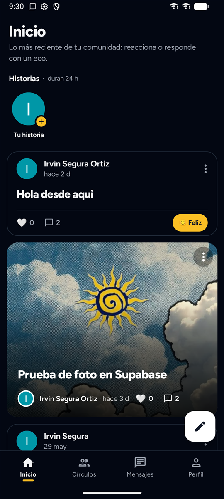
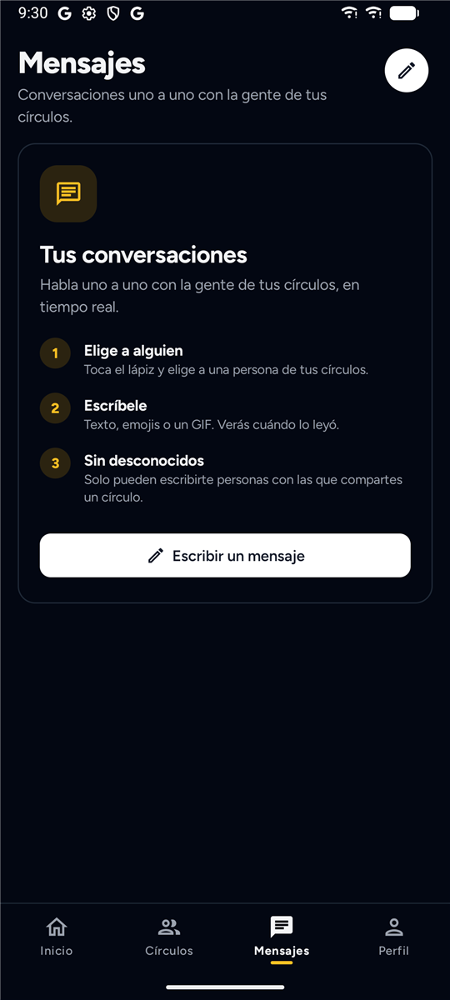

# Nexus

Red social para Android construida con **Kotlin y Jetpack Compose**: feed con modo offline, historias de 24 horas con música, publicaciones multimedia, respuestas ("ecos") en varios formatos, **círculos privados** y **mensajes directos** entre la gente de tus círculos.

El objetivo del proyecto no es solo la app, sino cómo está construida: arquitectura modular, Clean Architecture con MVI, una sola fuente de verdad en Room y reglas de seguridad versionadas junto al código.

## Capturas

| Inicio | Detalle y ecos | Crear publicación |
|:---:|:---:|:---:|
|  |  |  |

| Círculos | Mensajes | Perfil |
|:---:|:---:|:---:|
|  |  |  |

---

## Funciones

**Feed**
- Paginación infinita con **Paging 3 y `RemoteMediator`** usando cursor (`createdAt` + `id`) sobre Firestore.
- **Modo offline**: Room es la fuente de verdad de la UI; el feed se ve sin conexión y se sincroniza al volver.
- **Reacciones con emoji optimistas**: se ven al instante y se revierten si el servidor falla, sin pisar un toque posterior.
- Skeletons de carga (shimmer) y pull-to-refresh.
- **Guardar y reportar** desde el menú ⋮ de cada tarjeta. El reporte pide un motivo y solo se puede enviar una vez por post (lo garantizan las reglas).

**Publicaciones**
- Texto, varias imágenes, nota de voz grabada en la app, archivos adjuntos, un GIF o emoji animado de Giphy, estado de ánimo y ubicación.
- **Subida en segundo plano**: el post aparece de inmediato como pendiente en el feed y la subida sigue aunque se cierre la pantalla. Si falla, se puede reintentar o descartar desde la tarjeta.
- **Fotos comprimidas** antes de subir (máximo 1600 px, JPEG 85, rotación EXIF corregida): una foto de 12 MP pasa de ~5 MB a ~300 KB.
- **Editar y eliminar** tu propio post desde el detalle. Se puede cambiar el texto y el estado de ánimo; al eliminarlo también se borran sus archivos. El feed y el perfil se actualizan solos.

**Ecos (respuestas)**
- Texto, emoji, GIF o emoji animado (Giphy), imagen o audio, con su contador validado por las reglas de Firestore.

**Historias**
- Imagen, video, texto con degradados, reels y posts compartidos. Caducan a las 24 horas.
- **Música de fondo**: búsqueda en iTunes (y Spotify en builds debug), eligiendo desde qué segundo suena el fragmento.
- Reproducción de video y audio con **Media3 / ExoPlayer** y registro de historias vistas.

**Perfil**
- Encabezado con avatar y totales: publicaciones, ecos recibidos y reacciones recibidas.
- Pestañas **Publicaciones** y **Guardados**. Quitar un guardado se puede deshacer desde el snackbar, y los guardados de posts que ya no existen se limpian solos.
- **Ajustes**: tema Sistema / Claro / Oscuro (también cambia las barras del sistema) y cerrar sesión con confirmación.

**Círculos**
- Grupos pequeños (hasta 30 personas) con nombre, emoji y color. Quien lo crea es su dueño.
- Se entra con un **código de invitación** de 8 caracteres, sin letras ni números que se confundan (O/0, I/1). Se comparte con el menú de Android o se copia.
- El dueño puede **quitar a alguien** (el código cambia solo, para que no vuelva a entrar con él), **cambiar el código** o **eliminar el círculo**. Los demás pueden salir.
- Al publicar se elige la audiencia: **Público** o un círculo. Lo que se publica en un círculo **solo lo ven sus miembros**: no aparece en Inicio y las reglas de Firestore rechazan cualquier lectura o consulta de alguien de fuera.
- Cada círculo tiene sus pestañas Publicaciones y Miembros, y un botón para escribirle a cualquiera de ellos.

**Mensajes**
- Conversaciones uno a uno en tiempo real, **solo entre personas que comparten un círculo**, para que no lleguen mensajes de desconocidos.
- Contador de no leídos en la pestaña y en cada conversación, separadores por día y "Visto" en tu último mensaje leído.
- El mensaje aparece al instante (escritura local de Firestore) con un reloj hasta que el servidor lo confirma; si falla, el texto vuelve al campo.
- Texto, emoji, y GIFs o emojis animados de Giphy (se guarda solo el enlace de Giphy). Fotos no: las de la app viven en un bucket público de Supabase, así que mandarlas por ahí no sería privado de verdad.

**Diseño**
- Sistema visual tomado de IRSO BLOG: tipografía Figtree (fuente variable en `core-ui/res/font`, licencia OFL en `docs/licenses`), grises neutros, botón principal negro (blanco en modo oscuro), acento ámbar para etiquetas y estados, tarjetas con borde fino, avatares con iniciales sobre una paleta de 8 colores y animación de entrada en cascada.
- **Publicaciones como las entradas destacadas del blog**: con foto o GIF, la imagen llena la tarjeta y encima, sobre un degradado oscuro, van el estado de ánimo en una pastilla ámbar, el texto como titular, el autor, la fecha, las reacciones y los ecos. Sin imagen es una tarjeta con borde y el mismo orden. Un toque en el corazón reacciona; mantenerlo abre las cinco reacciones.
- Componentes compartidos en `core-ui` (`NexusPostCard`, `NexusCard`, `NexusPill`, `CircleBadge`, `UserAvatar`, `NexusEmptyState`, botones) que usan todos los módulos. El selector de Giphy (pestañas GIF y Emoji) vive en `core-giphy`.

**Autenticación**
- Email y contraseña, y Google Sign-In con **Credential Manager**. La sesión se guarda en DataStore.

---

## Stack

| Área | Tecnologías |
|---|---|
| Lenguaje y UI | Kotlin 2.0, Jetpack Compose, Material 3, Navigation Compose |
| Arquitectura | Clean Architecture (data / domain / presentation), MVI, multi-módulo |
| Inyección de dependencias | Hilt |
| Asincronía | Coroutines y Flow |
| Datos locales | Room, Paging 3, DataStore |
| Backend | Firebase Auth y Firestore; archivos en Supabase Storage (con el token de Firebase) |
| Red | Retrofit, OkHttp, kotlinx.serialization |
| Media | Media3 (ExoPlayer) con caché en disco, Coil, grabación de audio, compresión de fotos |
| APIs externas | Giphy, iTunes Search, Spotify (opcional) |
| Tests | JUnit 4, MockK, Turbine, kotlinx-coroutines-test |

---

## Arquitectura

El proyecto está dividido en módulos `core` reutilizables y módulos `feature` independientes. Cada feature tiene sus tres capas, y la capa `domain` no depende de Android ni de Firebase.

```
Nexus/
├── app/                     # Entry point, navegación raíz
├── core/
│   ├── core-common/         # NexusResult, dispatchers, ApplicationScope, event bus
│   ├── core-ui/             # Design system: tema, tipografía y componentes
│   ├── core-datastore/      # Sesión y preferencias (tema) con DataStore
│   ├── core-firebase/       # Firebase, acciones compartidas (guardar, reportar) y directorio de círculos
│   ├── core-storage/        # Subida de archivos a Supabase Storage
│   └── core-giphy/          # Cliente de Giphy y selector de GIFs y emojis animados
└── feature/
    ├── feature-auth/        # Login, registro, Google Sign-In
    ├── feature-feed/        # Feed paginado e historias
    ├── feature-post/        # Crear, editar y borrar post (público o de un círculo); detalle y ecos
    ├── feature-profile/     # Perfil, guardados y ajustes
    ├── feature-circles/     # Círculos: crear, unirse con código, miembros y sus publicaciones
    └── feature-messages/    # Mensajes directos entre gente que comparte un círculo
        ├── data/            # DataSources, DTOs, mappers, Repository impl
        ├── domain/          # Modelos, interfaces de Repository, Use Cases
        └── presentation/    # ViewModels (MVI), pantallas Compose, DI
```

**Flujo de datos del feed**

```
Firestore ──► FeedRemoteMediator ──► Room ──► PagingSource ──► FeedViewModel ──► FeedScreen
                                      ▲
                     reacciones optimistas escriben aquí primero
```

Cada pantalla define un `Contract` (estado, eventos y efectos) y su ViewModel expone un único `StateFlow` de estado.

### Decisiones técnicas

- **Room como única fuente de verdad.** La UI nunca lee directamente de Firestore. Así el modo offline y las actualizaciones optimistas salen sin lógica extra en las pantallas.
- **Subidas fuera del ciclo de vida del ViewModel.** `PostUploadManager` corre en un `ApplicationScope`, para que cerrar la pantalla de crear post no cancele la subida.
- **La seguridad está en el servidor.** `firestore.rules` valida la estructura de cada documento, que las URLs de archivos apunten a la carpeta del autor, los contadores de ecos, la caducidad de las historias y que cada usuario reporte un post una sola vez. Las políticas de Supabase (`supabase/storage-setup.sql`) solo dejan escribir a cada usuario en su carpeta. El cliente no es de confianza.
- **Ningún feature depende de otro.** Lo que comparten (guardar, reportar, avisar de un post editado o borrado, la lista de círculos) vive en `core-firebase` y en el event bus de `core-common`. Cerrar sesión, "publicar en este círculo" y "escribirle a este miembro" llegan desde el módulo `app`.
- **La privacidad de los círculos la decide el servidor.** Unirse exige escribir, en el mismo batch, una prueba con el código vigente (`circles/{id}/members/{uid}`), y las reglas la comparan con el código del círculo. Las consultas de posts tienen que filtrar por `circleId`, porque Firestore rechaza una consulta que *podría* devolver posts privados aunque no los devuelva.
- **Una conversación por pareja.** El id es `uidA_uidB` ordenado, así no hay duplicados ni búsquedas. Crear una exige un círculo que ambos compartan, y el mensaje y el resumen de la conversación (último texto, no leídos) se escriben en el mismo batch.

---

## Tests

Hay tests unitarios en la capa de dominio, datos y presentación: validación y casos de uso de auth, `FeedRemoteMediator`, reacciones optimistas con rollback, mappers, refresco del feed (y que un post de círculo nunca entre en Inicio), `PostUploadManager`, el event bus, el perfil (totales, orden de guardados, limpieza de posts borrados), las rutas de Supabase, los círculos (crear, unirse con código, salir, quitar miembros, posts pendientes) y los mensajes (primer mensaje, sin círculo en común, reintento, marcar como leído, "Visto").

Las reglas de Firestore tienen 115 pruebas para el emulador: posts, historias, guardados, reportes, edición y borrado, y además círculos, invitaciones, visibilidad de posts privados, mensajes directos, que los GIF solo vengan de Giphy y los hilos de ecos (respuestas de un nivel, menciones y corazones).

```bash
./gradlew test
```

---

## Cómo ejecutarlo

Requisitos: Android Studio reciente, JDK 17 y `minSdk 26`.

1. Clona el repo y ábrelo en Android Studio.
2. Crea un proyecto en Firebase, descarga `google-services.json` y colócalo en `app/`.
3. Agrega las claves en `local.properties` (`GIPHY_API_KEY` y, opcionalmente, las de Spotify).
4. Crea el proyecto de Supabase, pon `SUPABASE_URL` y `SUPABASE_ANON_KEY` en `local.properties` y ejecuta `supabase/storage-setup.sql`.
5. Publica las reglas y los índices de Firestore: `firebase deploy --only firestore:rules,firestore:indexes`.

La guía paso a paso (Google Sign-In, SHA-1, claves, Supabase y reglas) está en **[SETUP.md](SETUP.md)**.

---

## Próximos pasos

- Mover las subidas a **WorkManager** para que sobrevivan a que el sistema cierre la app.
- Notificaciones push de ecos y reacciones.
- Tests de UI con Compose.
- Perfiles de otros usuarios y seguir a personas.
- Fotos en mensajes con un bucket privado y URLs firmadas.
- Enlace de invitación que abra la app directamente (App Links), además del código.
- Panel de moderación para los reportes (hoy se revisan en la consola de Firebase).
