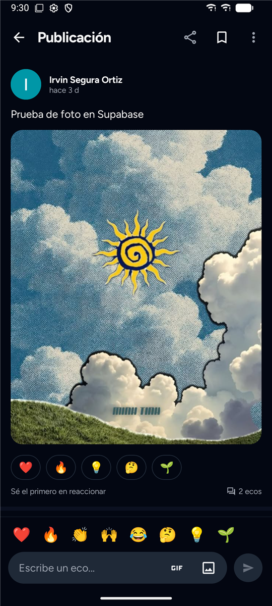
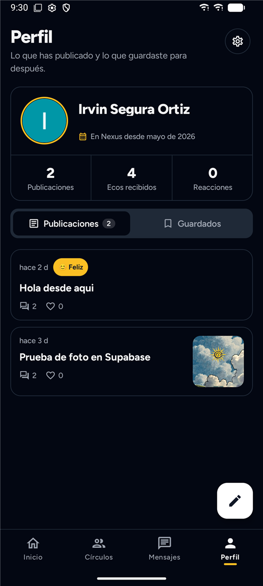
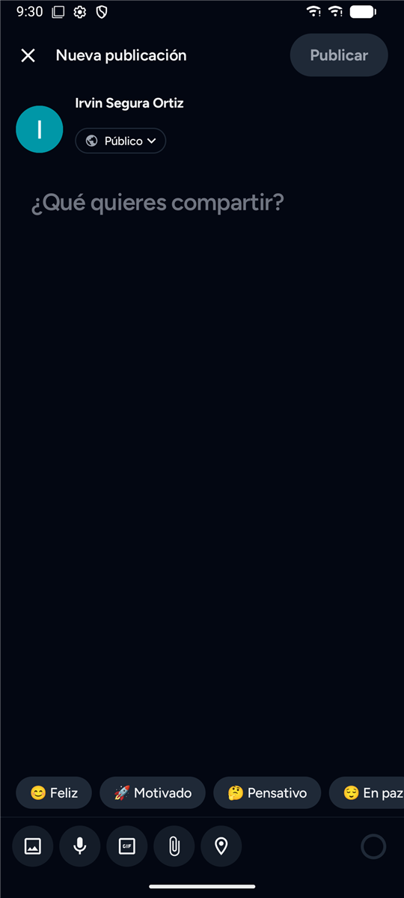
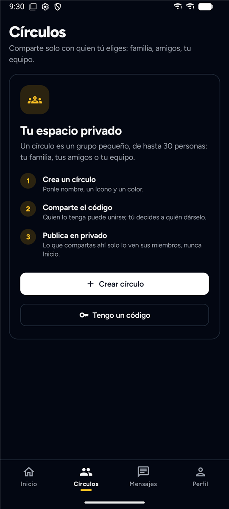

<div align="center">

# Nexus

**Una red social para Android pensada para compartir con tu gente: feed público, círculos privados y mensajes solo entre quienes se conocen.**

Feed con modo offline, historias de 24 horas con música, publicaciones multimedia, respuestas ("ecos") en varios formatos,
círculos privados con código de invitación y mensajes directos en tiempo real.

[](https://github.com/IrvinSegura/Nexus/actions/workflows/android-ci.yml)


-3DDC84?logo=android&logoColor=white)


[Capturas](#capturas) ·
[Funcionalidades](#funcionalidades) ·
[Arquitectura](#arquitectura) ·
[Seguridad](#seguridad) ·
[Pruebas](#pruebas) ·
[Cómo ejecutarlo](#cómo-ejecutarlo)


&nbsp;&nbsp;

&nbsp;&nbsp;


</div>

---

## Tabla de contenido

- [En pocas palabras](#en-pocas-palabras)
- [Lo más destacado](#lo-más-destacado)
- [Capturas](#capturas)
- [Funcionalidades](#funcionalidades)
- [Stack tecnológico](#stack-tecnológico)
- [Arquitectura](#arquitectura)
- [Decisiones técnicas](#decisiones-técnicas)
- [Seguridad](#seguridad)
- [Pruebas](#pruebas)
- [Cómo ejecutarlo](#cómo-ejecutarlo)
- [Estructura del repositorio](#estructura-del-repositorio)

## En pocas palabras

| | |
|---|---|
| **Qué es** | Una app nativa de Android con Kotlin y Jetpack Compose: publicar, reaccionar, responder, contar historias y hablar con tu gente. |
| **Qué la hace distinta** | Lo que se comparte en un círculo solo lo ven sus miembros, y los mensajes solo llegan de personas con las que compartes un círculo. Lo garantiza el servidor, no la app. |
| **Cómo está construida** | Multi-módulo, Clean Architecture con MVI, Room como única fuente de verdad y reglas de seguridad versionadas junto al código. |
| **Backend** | Firebase Auth y Firestore para los datos; Supabase Storage para fotos, audio y archivos, autenticado con el token de Firebase. |

## Lo más destacado

- **Funciona sin conexión**: el feed se lee de Room, así que se ve sin internet y se sincroniza solo al volver.
- **Respuesta inmediata**: las reacciones, los posts nuevos y los mensajes aparecen al instante y se revierten si el servidor falla.
- **Subidas que no se pierden**: el post aparece como pendiente en el feed y la subida sigue aunque cierres la pantalla; si falla, se reintenta o se descarta desde la tarjeta.
- **Círculos privados de verdad**: grupos de hasta 30 personas con código de invitación. Las reglas de Firestore rechazan cualquier lectura de alguien de fuera.
- **Mensajes sin desconocidos**: conversaciones uno a uno en tiempo real solo con gente de tus círculos, con no leídos y "Visto".
- **Historias con música**: imagen, video o texto, con un fragmento de canción elegido al segundo.
- **Diseño propio**: un sistema visual compartido por todos los módulos, con tema claro, oscuro o del sistema.

## Capturas

<table>
  <tr>
    <td width="33%" align="center"><br><sub><b>Inicio.</b> Historias arriba y publicaciones con imagen a pantalla completa o como tarjeta de texto.</sub></td>
    <td width="33%" align="center"><br><sub><b>Detalle.</b> Cinco reacciones, ecos en texto, emoji, GIF, imagen o audio, y opciones para guardar o compartir.</sub></td>
    <td width="33%" align="center"><br><sub><b>Crear publicación.</b> Audiencia pública o de un círculo, estado de ánimo, fotos, nota de voz, GIF, archivos y ubicación.</sub></td>
  </tr>
  <tr>
    <td align="center"><br><sub><b>Círculos.</b> Crea un grupo privado o únete con un código de 8 caracteres.</sub></td>
    <td align="center"><br><sub><b>Mensajes.</b> Conversaciones uno a uno, solo con gente de tus círculos.</sub></td>
    <td align="center"><br><sub><b>Perfil.</b> Totales de publicaciones, ecos y reacciones, con pestañas de publicaciones y guardados.</sub></td>
  </tr>
</table>

## Funcionalidades

### Feed

- Paginación infinita con **Paging 3 y `RemoteMediator`**, usando un cursor (`createdAt` + `id`) sobre Firestore.
- **Modo offline**: Room es la fuente de verdad de la UI; el feed se ve sin conexión y se sincroniza al volver.
- **Reacciones con emoji optimistas**: se ven al instante y se revierten si el servidor falla, sin pisar un toque posterior.
- Skeletons de carga (shimmer) y pull-to-refresh.
- **Guardar y reportar** desde el menú ⋮ de cada tarjeta. El reporte pide un motivo y solo se puede enviar una vez por post.

### Publicaciones

- Texto, varias imágenes, nota de voz grabada en la app, archivos adjuntos, un GIF o emoji animado de Giphy, estado de ánimo y ubicación.
- **Subida en segundo plano**: el post aparece de inmediato como pendiente y la subida sigue aunque se cierre la pantalla.
- **Fotos comprimidas** antes de subir (máximo 1600 px, JPEG 85, rotación EXIF corregida): una foto de 12 MP pasa de ~5 MB a ~300 KB.
- **Editar y eliminar** tu propio post. Se cambian el texto y el estado de ánimo; al eliminarlo también se borran sus archivos, y el feed y el perfil se actualizan solos.

### Ecos (respuestas)

- Texto, emoji, GIF o emoji animado de Giphy, imagen o audio, con su contador validado por las reglas de Firestore.

### Historias

- Imagen, video, texto con degradados, reels y posts compartidos. Caducan a las 24 horas.
- **Música de fondo**: búsqueda en iTunes (y Spotify en builds debug), eligiendo desde qué segundo suena el fragmento.
- Reproducción de video y audio con **Media3 / ExoPlayer** y registro de historias vistas.

### Círculos

- Grupos pequeños (hasta 30 personas) con nombre, emoji y color. Quien lo crea es su dueño.
- Se entra con un **código de invitación** de 8 caracteres, sin letras ni números que se confundan (O/0, I/1). Se comparte con el menú de Android o se copia.
- El dueño puede **quitar a alguien** (el código cambia solo, para que no vuelva a entrar con él), **cambiar el código** o **eliminar el círculo**. Los demás pueden salir.
- Al publicar se elige la audiencia: **Público** o un círculo. Lo que se publica en un círculo no aparece en Inicio.
- Cada círculo tiene sus pestañas Publicaciones y Miembros, y un botón para escribirle a cualquiera de ellos.

### Mensajes

- Conversaciones uno a uno en tiempo real, **solo entre personas que comparten un círculo**.
- Contador de no leídos en la pestaña y en cada conversación, separadores por día y "Visto" en tu último mensaje leído.
- El mensaje aparece al instante con un reloj hasta que el servidor lo confirma; si falla, el texto vuelve al campo.
- Texto, emoji, y GIFs o emojis animados de Giphy (se guarda solo el enlace de Giphy).

### Perfil y ajustes

- Encabezado con avatar y totales: publicaciones, ecos recibidos y reacciones recibidas.
- Pestañas **Publicaciones** y **Guardados**. Quitar un guardado se deshace desde el snackbar, y los guardados de posts que ya no existen se limpian solos.
- Tema Sistema, Claro u Oscuro (también cambia las barras del sistema) y cerrar sesión con confirmación.

### Autenticación

- Email y contraseña, y Google Sign-In con **Credential Manager**. La sesión se guarda en DataStore.

### Diseño

- Tipografía Figtree (fuente variable en `core-ui/res/font`, licencia OFL en `docs/licenses`), grises neutros, botón principal negro (blanco en modo oscuro) y acento ámbar para etiquetas y estados.
- **Publicaciones como portadas**: con foto o GIF, la imagen llena la tarjeta y encima, sobre un degradado oscuro, van el estado de ánimo, el texto como titular, el autor, la fecha, las reacciones y los ecos. Un toque en el corazón reacciona; mantenerlo abre las cinco reacciones.
- Componentes compartidos en `core-ui` (`NexusPostCard`, `NexusCard`, `NexusPill`, `CircleBadge`, `UserAvatar`, `NexusEmptyState`, botones) y el selector de Giphy en `core-giphy`.

## Stack tecnológico

| Área | Tecnología |
|---|---|
| Lenguaje y UI | Kotlin 2.0, Jetpack Compose, Material 3, Navigation Compose |
| Arquitectura | Clean Architecture (data / domain / presentation), MVI, multi-módulo |
| Inyección de dependencias | Hilt |
| Asincronía | Coroutines y Flow |
| Datos locales | Room, Paging 3, DataStore |
| Backend | Firebase Auth y Firestore; archivos en Supabase Storage (con el token de Firebase) |
| Red | Retrofit, OkHttp, kotlinx.serialization |
| Media | Media3 (ExoPlayer) con caché en disco, Coil, grabación de audio, compresión de fotos |
| APIs externas | Giphy, iTunes Search, Spotify (opcional) |
| Pruebas | JUnit 4, MockK, Turbine, kotlinx-coroutines-test |
| CI | GitHub Actions: compila el APK de debug y corre las pruebas unitarias en cada PR |

## Arquitectura

El proyecto está dividido en módulos `core` reutilizables y módulos `feature` independientes. Cada feature tiene sus tres capas, y la capa `domain` no depende de Android ni de Firebase.

```
app ──────────────► feature-* ──────────────► core-*
(navegación raíz)   (data · domain · presentation)   (ui, firebase, storage, datastore, giphy, common)
```

**Flujo de datos del feed**

```
Firestore ──► FeedRemoteMediator ──► Room ──► PagingSource ──► FeedViewModel ──► FeedScreen
                                      ▲
                     reacciones optimistas escriben aquí primero
```

Cada pantalla define un `Contract` (estado, eventos y efectos) y su ViewModel expone un único `StateFlow` de estado.

## Decisiones técnicas

- **Room como única fuente de verdad.** La UI nunca lee directamente de Firestore. Así el modo offline y las actualizaciones optimistas salen sin lógica extra en las pantallas.
- **Subidas fuera del ciclo de vida del ViewModel.** `PostUploadManager` corre en un `ApplicationScope`, para que cerrar la pantalla de crear post no cancele la subida.
- **Ningún feature depende de otro.** Lo que comparten (guardar, reportar, avisar de un post editado o borrado, la lista de círculos) vive en `core-firebase` y en el event bus de `core-common`. Cerrar sesión, "publicar en este círculo" y "escribirle a este miembro" llegan desde el módulo `app`.
- **Una conversación por pareja.** El id es `uidA_uidB` ordenado, así no hay duplicados ni búsquedas. El mensaje y el resumen de la conversación (último texto, no leídos) se escriben en el mismo batch.
- **Consultas que respetan la privacidad.** Las consultas de posts filtran por `circleId`, porque Firestore rechaza una consulta que *podría* devolver posts privados aunque no los devuelva.
- **Archivos en Supabase.** Firebase Storage exige el plan Blaze, así que los archivos viven en Supabase Storage, que acepta el token de Firebase para saber quién sube cada uno.

## Seguridad

El cliente no es de confianza: todo lo importante lo valida el servidor.

- **Estructura de los documentos**: `firestore.rules` valida los campos de cada post, eco, historia, círculo y mensaje, y los contadores de ecos.
- **Archivos de cada autor**: las URLs de archivos tienen que apuntar a la carpeta de quien publica, y las políticas de Supabase (`supabase/storage-setup.sql`) solo dejan escribir a cada usuario en la suya.
- **Círculos**: unirse exige escribir, en el mismo batch, una prueba con el código vigente (`circles/{id}/members/{uid}`), y las reglas la comparan con el código del círculo. Los posts de un círculo solo los leen sus miembros.
- **Mensajes**: crear una conversación exige un círculo que ambos compartan.
- **Historias y reportes**: las historias caducan a las 24 horas y cada usuario reporta un post una sola vez.
- **GIFs**: solo se aceptan enlaces de Giphy.
- **Fotos en mensajes**: no se permiten, porque el bucket de la app es público y mandarlas por ahí no sería privado de verdad.

## Pruebas

107 pruebas unitarias en las capas de dominio, datos y presentación: validación y casos de uso de auth, `FeedRemoteMediator`, reacciones optimistas con rollback, mappers, refresco del feed (y que un post de círculo nunca entre en Inicio), `PostUploadManager`, el event bus, el perfil (totales, orden de guardados, limpieza de posts borrados), las rutas de Supabase, los círculos (crear, unirse con código, salir, quitar miembros, posts pendientes) y los mensajes (primer mensaje, sin círculo en común, reintento, marcar como leído, "Visto").

```bash
./gradlew test
```

GitHub Actions compila el APK de debug y corre estas pruebas en cada pull request.

## Cómo ejecutarlo

**Requisitos:** Android Studio reciente, JDK 17 o superior y un dispositivo o emulador con Android 8.0 (API 26) o más.

1. Clona el repo y ábrelo en Android Studio.
2. Crea un proyecto en Firebase, descarga `google-services.json` y colócalo en `app/`.
3. Agrega las claves en `local.properties` (`GIPHY_API_KEY` y, opcionalmente, las de Spotify).
4. Crea el proyecto de Supabase, pon `SUPABASE_URL` y `SUPABASE_ANON_KEY` en `local.properties` y ejecuta `supabase/storage-setup.sql`.
5. Publica las reglas y los índices de Firestore:

   ```bash
   firebase deploy --only firestore:rules,firestore:indexes
   ```

6. Ejecuta la configuración `app` desde Android Studio.

> [!TIP]
> Sin las claves de Giphy y Spotify la app compila y funciona igual: solo se desactivan el selector de GIFs y la búsqueda en Spotify.

La guía paso a paso (Google Sign-In, SHA-1, claves, Supabase y reglas) está en **[SETUP.md](SETUP.md)**.

## Estructura del repositorio

```
Nexus/
├── .github/workflows/          # CI: compila el APK de debug y corre las pruebas unitarias
├── app/                        # MainActivity, NexusApp y navegación raíz (NexusNavHost, MainScreen)
├── core/
│   ├── core-common/            # NexusResult, dispatchers, ApplicationScope, event bus, extensiones y media
│   ├── core-ui/                # Sistema de diseño: tema, tipografía Figtree, componentes y compartir
│   ├── core-datastore/         # Sesión y preferencias (tema) con DataStore
│   ├── core-firebase/          # Firebase, acciones compartidas (guardar, reportar) y directorio de círculos
│   ├── core-storage/           # Subida de archivos a Supabase Storage y rutas por usuario
│   └── core-giphy/             # Cliente de Giphy y selector de GIFs y emojis animados
├── feature/
│   ├── feature-auth/           # Login, registro, Google Sign-In
│   ├── feature-feed/           # Feed paginado e historias
│   ├── feature-post/           # Crear, editar y borrar posts; detalle y ecos
│   ├── feature-profile/        # Perfil, guardados y ajustes
│   ├── feature-circles/        # Círculos: crear, unirse con código, miembros y publicaciones
│   └── feature-messages/       # Mensajes directos entre gente que comparte un círculo
├── supabase/storage-setup.sql  # Buckets y políticas de Supabase Storage
├── scripts/                    # configure-supabase.ps1: conecta la app a un proyecto de Supabase en un paso
├── prototypes/                 # Prototipo HTML de las tarjetas de publicación
├── docs/                       # Capturas, licencia de la fuente e informe de revisión
├── firestore.rules             # Reglas de seguridad de Firestore
├── firestore.indexes.json      # Índices compuestos
├── firebase.json, .firebaserc  # Configuración de Firebase CLI
├── compose-stability.conf      # Clases que el compilador de Compose trata como estables
└── SETUP.md                    # Guía de configuración paso a paso
```

Cada módulo `feature-*` tiene las mismas capas:

```
feature-xxx/
├── data/           # DataSources, DTOs, mappers e implementación del Repository
├── domain/         # Modelos, interfaces de Repository y casos de uso (sin Android ni Firebase)
└── presentation/   # ViewModels (MVI), pantallas Compose y módulos de Hilt
```
